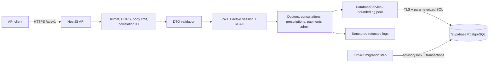

# Architecture — Amrutam MVP

## System boundary

Amrutam is a modular NestJS REST API deployed as one stateless application process. It owns authentication and telemedicine business rules and accesses Supabase-managed PostgreSQL through the central `DatabaseService` and `pg`. Clients never receive database credentials or query PostgreSQL directly. The modular monolith keeps ownership checks and booking transactions understandable; microservices would add distributed failure modes without measured justification.

There is no ORM, Redis, message broker, Supabase Auth, GraphQL server, or frontend. The payments module records internal attempts only and does not represent real provider processing. The outbox is populated atomically by consultation workflows, but delivery workers remain future work.

## HTTP and module flow

The API uses `/api/v1`; Swagger UI is mounted at `/api/docs` when enabled. Middleware assigns a safe request ID and logs method, path, status, and latency without bodies or query strings. A global validation pipe transforms declared DTO fields, rejects unknown fields, and prevents mass assignment. The global exception filter preserves safe expected messages and converts unexpected errors to a generic response while retaining server-side diagnostics.

The authentication module is global through guards. Public endpoints are explicitly marked. Protected requests must carry an HS256 access JWT whose subject, role, and session ID match an active, unexpired database session and active user. The roles guard enforces controller-level role requirements; services enforce resource ownership and doctor assignment. Controllers handle HTTP mapping, services own business rules, and SQL remains close to the owning module.

## Authentication and sessions

Registration creates only an active patient, hashes the password with Argon2id, creates the profile and initial session, and appends an audit event in one transaction. Login uses a generic failure response and creates a new session. Access JWTs are short lived. Refresh tokens are 256-bit random opaque values; only their SHA-256 hashes are stored. Refresh rotates the previous session to `rotated`, creates one active child in the same family, and returns a new pair. Reuse of a rotated token marks the active family descendant `compromised`. Logout revokes the current session. Every protected request performs a database session check, so logout, compromise, suspension, or role changes take effect immediately.

Sensitive auth endpoints use bounded in-process throttling. This is suitable for the MVP and local demonstration, not a multi-replica global limit; production should add a trusted ingress or distributed limiter. MFA persistence exists in the schema, but no enrollment or challenge flow is claimed.

The first administrator is created only through the one-time server-side bootstrap script. Public registration cannot set a role. An administrator can promote an existing active account to a verified doctor, with license uniqueness and audit records enforced transactionally.

## Database and transaction boundary

`DatabaseService` owns one bounded pool per process. TLS certificate verification is enabled by default. External values always use PostgreSQL placeholders. `withTransaction` acquires one client, issues `BEGIN`, executes all work on that client, commits only on success, attempts rollback on failure, and releases in `finally`.

The process can start while PostgreSQL is unavailable: `/health` is liveness only, while `/health/ready` probes the database and returns sanitized `503` output. Shutdown hooks drain the pool.

The migration runner discovers ordered SQL files, acquires a session advisory lock, verifies immutable SHA-256 checksums, and records each migration in the same transaction as its SQL. Applied migrations `001`–`004` were not changed for the MVP.

## Booking and idempotency

Booking correctness is database-backed. In one transaction the service:

1. inserts or locks the authenticated actor’s scoped idempotency record;
2. rejects a reused key with a different request fingerprint or replays the committed safe response;
3. locks the slot and validates that it is open, future, and belongs to a verified active doctor;
4. inserts the scheduled consultation;
5. appends the audit row and outbox event;
6. marks the idempotency record complete with its response; and
7. commits before returning success.

A partial unique index on non-cancelled consultations is the final concurrent double-booking guard. The service maps a unique violation to HTTP `409`. Cancellation retains history but removes the row from that partial index, allowing exactly one replacement booking. Doctor interval overlap is independently rejected by a GiST exclusion constraint.

Consultation transitions lock the consultation, validate the current-to-target transition plus role/ownership, update lifecycle timestamps, append audit/outbox records, and complete idempotency in one transaction. Terminal states cannot transition. Prescriptions require the assigned doctor and a completed consultation. Payment creation requires the patient owner, exact decimal input, and idempotency; clients cannot set payment success.

## Search, analytics, and performance

Doctor search exposes only verified active doctors, supports bounded pagination and filters, and can require an unbooked open slot within a UTC-aware interval. Consultation history uses patient/doctor indexes. Admin analytics accepts a maximum 366-day range and returns only aggregates: consultation counts, payment totals, and doctor slot utilization.

The assignment’s 100,000-consultation/day and latency objectives are targets, not measured claims. Purpose-built indexes and bounded responses support initial scale, but representative load tests and `EXPLAIN ANALYZE` evidence remain required. Caching is deliberately absent: booking correctness must never depend on cache consistency. Partitioning is deferred because it complicates global per-slot uniqueness and has not been justified by measurements.

## Operations and remaining work

The multi-stage Docker image installs from the lockfile and runs as the unprivileged `node` user. Compose injects ignored runtime environment values and starts no second database. CI checks formatting, lint, strict TypeScript, build, tests, and high-severity advisories.

Structured JSON logs and request IDs are implemented. Metrics, distributed traces, outbox delivery/retry processing, MFA, email verification, password recovery, distributed rate limiting, measured load results, backup/restore exercises, automated retention, and a least-privilege database grant deployment remain incomplete and are explicitly not claimed.
