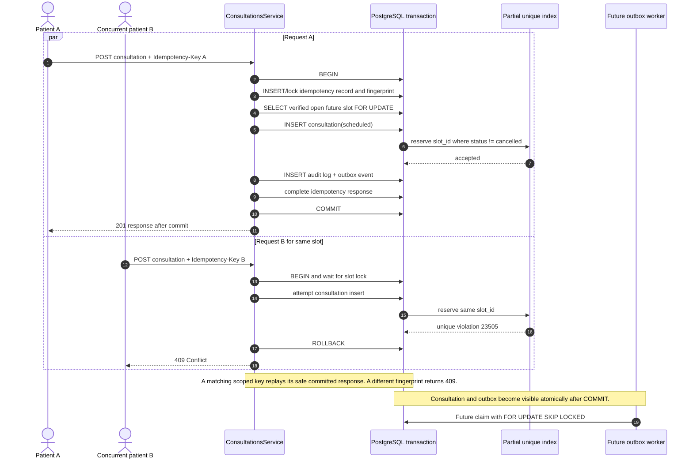

# Implemented booking transaction sequence

`POST /api/v1/consultations` implements the transaction below. The outbox worker shown after commit is planned and not implemented.

Cancellation is another idempotent transaction. It locks the consultation, validates patient/doctor/admin authority and the transition, sets cancellation fields, appends audit/outbox records, completes idempotency, and commits. The cancelled historical row no longer participates in the partial unique index, so one replacement booking can succeed.
