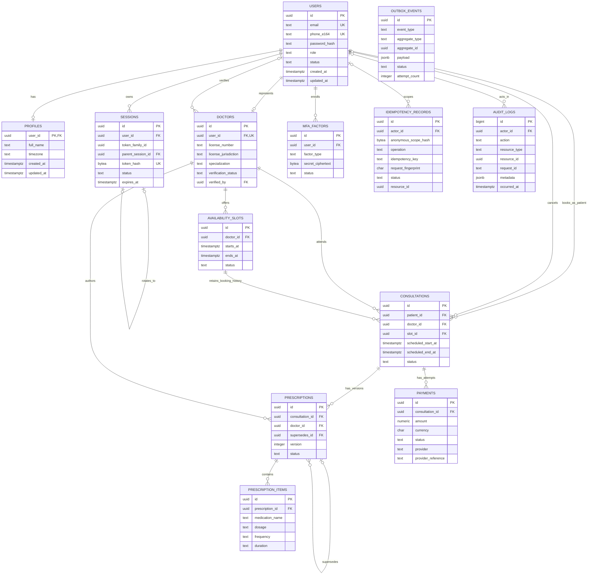

# Amrutam relational model

The diagram shows physical foreign-key cardinalities. Generic `resource_id`/`aggregate_id` values in audit, idempotency, and outbox records deliberately have no polymorphic foreign key.

Important cardinality nuance: one availability slot may have many historical cancelled consultations, but the partial unique index permits at most one consultation whose status is not `cancelled`.
